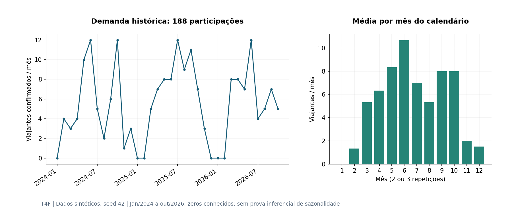
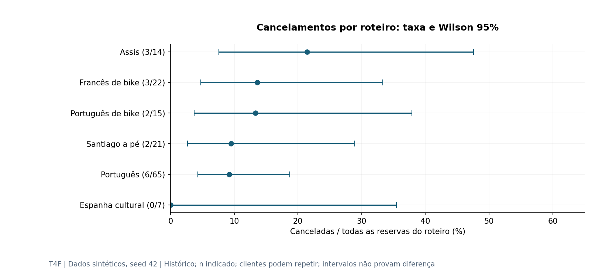
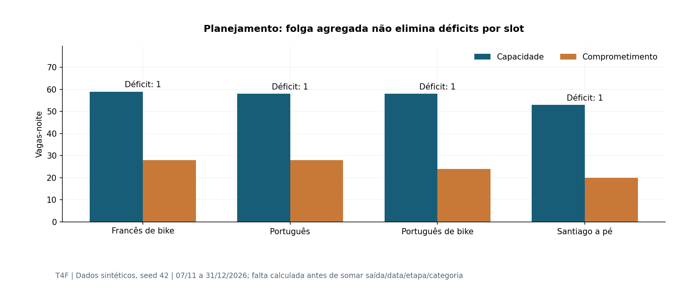
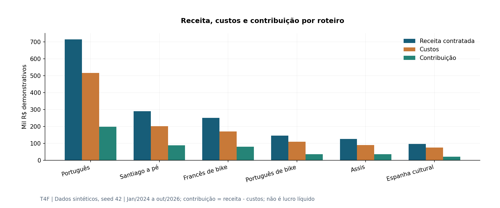
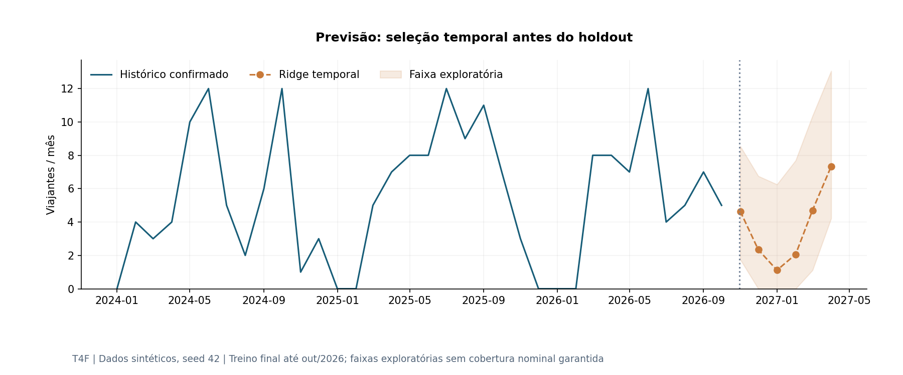

# Portfólio de Dados — T4F Performance | Tour4Friends

**Tour4Friends · Projeto Integrador V · Fatec Ipiranga**

Como conectar demanda, capacidade, experiência do cliente e contribuição para apoiar decisões de uma agência de roteiros do Caminho de Santiago?

Este portfólio apresenta o processo analítico do **T4F Performance**, desenvolvido no Projeto Integrador V, para a disciplina **Metodologias para Projetos de Big Data Analytics**, do professor **Samuel Henrique**. Reúne problema, origem dos dados, validação, indicadores, análises, visualizações e metodologias. A aplicação original continua no [Dashboards-Tour4Friends](https://github.com/Thiago-code-lab/Dashboards-Tour4Friends).

> **Dados demonstrativos sintéticos, seed 42.** Nenhum número representa o desempenho real da Tour4Friends. O cenário contém também Assis e Espanha cultural; seus registros foram preservados com o significado original.

## Resultados reproduzidos

Histórico de **janeiro/2024 a outubro/2026**, referência da base em **07/11/2026**. Quantidades abaixo pertencem à coorte histórica de viagens, salvo indicação.

| Indicador | Resultado calculado |
| --- | ---: |
| Reservas / confirmadas | 144 / 128 |
| Participações confirmadas / clientes únicos | 188 / 92 |
| NPS / respostas | 43,06 pontos / 72 |
| Cancelamentos | 16/144 = 11,11% |
| Receita contratada | R$ 1.618.600,00 |
| Custos / contribuição gerencial | R$ 1.161.182,00 / R$ 457.418,00 |
| Ocupação de hospedagem histórica | 738/1.723 = 42,83% em vagas-noite |

A base completa tem 164 reservas; as 20 restantes são futuras em relação ao histórico. Receita é contada uma vez por reserva, e contribuição não é lucro líquido.

- **Demanda:** junho tem média de 10,67 participações, com três repetições anuais. Antecipar investigação e negociação de capacidade; a série curta não comprova sazonalidade comercial.
- **Experiência:** Santiago a pé tem NPS 25 em 12 respostas e nota média de hospedagem 7,08/10. Revisar comentários e etapas; a amostra não prova causalidade.
- **Cancelamentos:** Assis apresenta 3/14 = 21,43%, Wilson de referência 7,57%–47,59%. Investigar motivos e canais; o intervalo amplo limita comparações.
- **Capacidade futura:** de 07/11 a 31/12/2026, há quatro vagas-noite em falta em slots específicos, apesar da ocupação agregada de 43,86%. Folgas de outras datas/etapas não compensam os déficits.
- **Previsão:** Ridge selecionado na validação temporal H=3, MAE 2,5817; no teste final, MAE 2,5567 viajantes/mês. A média ponderada teve menor MAE final, sem reseleção após observar o teste.

Os cálculos, decisões sugeridas e limitações estão em [resultados](docs/resultados.md) e no [notebook executado](notebooks/analise_exploratoria.ipynb). Não há inferência causal ou alegação de ganho real.

## Reprodução

Requisitos: **Python 3.12**, **Node.js 22.12+** e npm. No PowerShell, dentro deste diretório:

~~~powershell
python -m venv .venv
.\.venv\Scripts\python.exe -m pip install -r requirements.txt
npm.cmd ci
.\.venv\Scripts\python.exe -m src.ingestao
.\.venv\Scripts\python.exe -m src.gerar_demo
.\.venv\Scripts\python.exe -m src.executar
.\.venv\Scripts\python.exe -m src.suplementar
.\.venv\Scripts\python.exe -m src.visualizacoes
.\.venv\Scripts\python.exe -m src.resultados
.\.venv\Scripts\python.exe -m src.notebook
.\.venv\Scripts\python.exe -m src.relatorio
npm.cmd run typecheck
npm.cmd test
.\.venv\Scripts\python.exe -m unittest discover -s tests -v
~~~

Em Linux/macOS, use `.venv/bin/python` e `npm`. O fluxo foi executado em Windows/Python 3.12; outras plataformas não foram homologadas. `src.gerar_demo` reproduz o gerador original em pasta temporária e confere igualdade byte a byte, sem tocar no repositório original. `src.ingestao` verifica as fontes incorporadas; não depende de downloads. A instalação inicial das dependências requer acesso aos registries. O lock npm fixa a árvore Node; as dependências Python diretas estão fixadas.

~~~mermaid
flowchart LR
    A[Snapshot sintético e hashes] --> B[Schema e relações originais]
    B --> C[Indicadores e modelos TypeScript]
    C --> D[Reconciliação Python]
    D --> E[CSV e JSON]
    E --> F[Gráficos e notebook]
    E --> G[Streamlit]
    F --> H[PDF e narrativa profissional]
~~~

O núcleo de validação, KPIs, estatística e previsão foi incorporado **sem alterações**, a partir do commit integrado [0216dce](https://github.com/Thiago-code-lab/Dashboards-Tour4Friends/tree/0216dce5f67b83fbb0ba84346a7742dcb4f5ce23), em `vendor/t4f/`. [Manifesto](docs/fontes.json) registra SHA-256 e origem de cada arquivo. A seleção evita reconstruir regras já testadas e não inclui React, backend, documentos comerciais ou credenciais.

## Exploração local

~~~powershell
.\.venv\Scripts\python.exe -m streamlit run app.py --server.address 127.0.0.1
~~~

Abra http://127.0.0.1:8501. O leitor apresenta o histórico por roteiro e exporta o recorte. A aba de planejamento tem escopo global explícito. O cache depende da versão do arquivo; modelos e pipeline não executam em interações.

A CLI CSV genérica foi preservada: `python -m src.pipeline --help`.

## Análises e entregas

- [Relatório de portfólio em PDF](output/pdf/portfolio-t4f-performance.pdf).
- [Notebook executado](notebooks/analise_exploratoria.ipynb), com tabelas, contratos e interpretação.
- [LinkedIn preparado para revisão](portfolio/post-linkedin.md), sem publicação.
- [Panorama, CRISP-DM, KDD, Scrum, Kanban, DataOps, planejamento e Canvas](docs/metodologias.md), com evidências e limites.
- [Validação executada](docs/verificacao.md), [requisitos acadêmicos](docs/requisitos.md) e [planejamento](docs/planejamento.md).

## Documentação acadêmica e bases anexadas

- [Documento acadêmico do projeto, 30 páginas](docs/referencias/projeto-big-data-t4f-publico.pdf): cópia pública com matrículas ocultadas; os demais textos e figuras foram preservados.
- [Pacote de bases fornecido pelo autor](anexos/bases_de_dados_T4F.zip): ZIP original, byte a byte, com nove CSVs, planilha XLSX de dez abas, gerador e LEIA-ME.
- [Leitura e cotejo do documento](docs/leitura-documentacao.md), com páginas e distinção entre proposta, relato acadêmico e implementação executável.
- [Dicionário e qualidade da base complementar](docs/bases-suplementares.md), [CSVs consultáveis](data/suplementar/README.md) e [manifesto dos anexos](docs/anexos-manifesto.json).

**Duas simulações separadas:** a demonstração principal usa seed 42, BRL e Premium/Conforto/Alternativa. O ZIP usa seed 2026, reservas em EUR e Econômico/Standard/Superior; seu financeiro em BRL e sua ocupação são independentes de reservas. Os indicadores não são combinados.

A validação complementar reproduz o caso de Portomarín (14/11/2026): três vagas-noite para capacidade de duas, ocupação de 150%. O NPS 72 das 300 respostas foi imposto no gerador; sete respostas ocorrem depois de 16/11/2026. No corte, são 293 respostas e NPS 72,70 pontos. As tabelas externas do pacote são referências fornecidas de origem secundária ou calendário calculado, sem certificação primária nesta entrega.

O documento acadêmico descreve modelos e infraestrutura que não estão comprovados neste código. Não se declara execução de Random Forest, Regressão Logística, Power BI, quatro sprints ou automação semanal com base apenas no texto do PDF. O cotejo explicita também que o modelo genérico de repositório da página 28 não foi adotado.

## Origem e estado do projeto integrador

O original tem dez módulos de dashboards, demonstração React/TypeScript e laboratório FastAPI/PostgreSQL. Este repositório apresenta análise e processo; não duplica a plataforma.

Consulta de 17/11/2026: PRs #1–#3 integrados; #4–#8 abertos, sendo #6–#8 em rascunho. Os módulos comerciais/documentais e mapas pendentes não integram os resultados deste portfólio. [Arquitetura, módulos, testes e estado das branches](docs/projeto-original.md), [evidência dos PRs](docs/estado-original.json). A consulta HTTP da [demonstração original](https://thiago-code-lab.github.io/Dashboards-Tour4Friends/) retornou 200 e snapshot com o mesmo hash; isso não equivale a repetir toda a suíte pública.

## Estrutura

~~~text
app.py                     Leitor Streamlit dos resultados
src/                       Diagnóstico CSV e orquestração/entregas Python
scripts/exportar-t4f.ts     Adaptador do núcleo analítico original
vendor/t4f/                18 arquivos originais, com atribuição e hashes
data/raw/t4f-demo.json      Snapshot sintético versionado
data/processed/            Sete CSVs e JSONs analíticos locais regeneráveis
data/suplementar/           Nove CSVs anexados, preservados e validados à parte
anexos/                    ZIP original fornecido pelo autor
tests/                     Carteira manual, contratos e integração
notebooks/                 Análise executada
visualizacoes/             Seis gráficos calculados
docs/                      Problema, fontes, pipeline, métodos e evidências
output/pdf/                Relatório do portfólio
portfolio/                 Narrativa para LinkedIn
~~~

## Limitações e créditos

Série de 34 meses, poucos respondentes por grupo e dados inteiramente sintéticos. Wilson e bootstrap têm limitações de independência e seleção; faixas preditivas são exploratórias, sem cobertura garantida. A série usa status atuais das reservas, sem snapshots históricos de vendas. Não há conciliação contábil, previsão operacional validada ou reconciliação hierárquica. Vagas-noite e viajantes/mês são unidades distintas.

Projeto Integrador V: **Daniel Fernando dos Santos, Lucas Antonio Evangelista dos Santos, Pablo Roberto da Silva Costa, Thiago Cardoso Davi e William Nunes Vilany**. Organização deste portfólio: Thiago Cardoso Davi.

Publicação autorizada em **[portfolio-t4f-data-analytics](https://github.com/Thiago-code-lab/portfolio-t4f-data-analytics)**, branch `main`. O histórico público começa com uma raiz exclusiva do T4F; o histórico de trabalho anterior permanece em backup e branch locais. [Checklist de publicação](docs/checklist-publicacao.md). O Streamlit é uma aplicação local: a publicação no GitHub não o hospeda. O texto de LinkedIn permanece preparado, sem envio automático.
