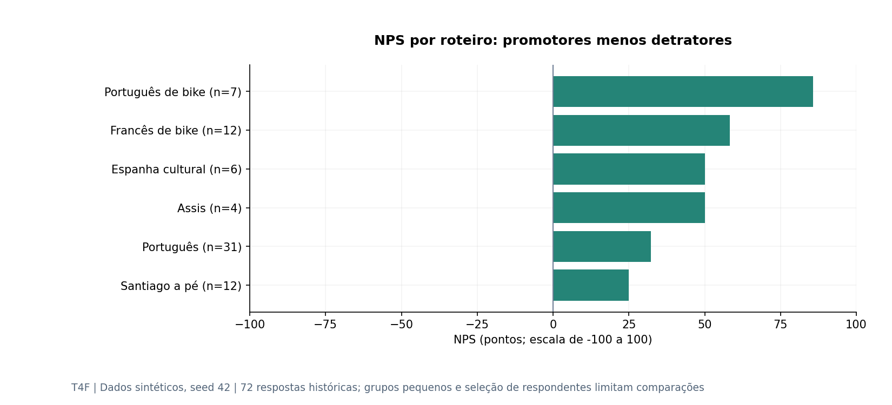

# Projeto de Big Data — T4F Performance | Tour4Friends

**Portfólio de Dados · Projeto Integrador V · Fatec Ipiranga**

**Disciplina:** Metodologias para Projetos de Big Data Analytics  
**Professor:** Samuel Henrique  
**Repositório deste portfólio:** https://github.com/Thiago-code-lab/portfolio-t4f-data-analytics  
**Aplicação original:** [Dashboards-Tour4Friends](https://github.com/Thiago-code-lab/Dashboards-Tour4Friends)

Este repositório reúne a definição do problema, a base de dados, o pipeline, as análises, as visualizações, os resultados e as metodologias aplicadas ao **T4F Performance**, solução de Business Intelligence para a Tour4Friends.

## 1. Problema de negócio

A Tour4Friends organiza roteiros de peregrinação, incluindo os Caminhos Francês e Português de Santiago. Para apoiar o planejamento da operação, precisa reunir informações que normalmente são acompanhadas separadamente: procura por viagens, reservas, capacidade das hospedagens, satisfação dos clientes e indicadores financeiros.

**Pergunta central:** como transformar esses dados em indicadores confiáveis para orientar decisões comerciais e operacionais?

**Objetivos do projeto:**
- Identificar padrões e variações da demanda.
- Acompanhar reservas, cancelamentos e capacidade por saída e hospedagem.
- Avaliar a experiência dos viajantes por meio de notas e NPS.
- Relacionar receita contratada, custos e contribuição gerencial.
- Demonstrar a preparação, a análise e a visualização de dados em um fluxo reproduzível.

## 2. Base de dados: origem e descrição

| Campo | Descrição |
| --- | --- |
| **Origem principal** | [T4F Performance — Projeto Integrador V](https://github.com/Thiago-code-lab/Dashboards-Tour4Friends), a partir de um snapshot versionado do cenário de desenvolvimento. |
| **Arquivo de origem** | [data/raw/t4f-demo.json](data/raw/t4f-demo.json) |
| **Descrição** | Registros estruturados de clientes, leads, reservas, saídas, roteiros, hospedagens, pagamentos, custos e avaliações. |
| **Período histórico** | Janeiro de 2024 a outubro de 2026. |
| **Unidades de análise** | Reservas, participações de viajantes, avaliações, meses e vagas-noite de hospedagem. |
| **Dados tratados** | Gerados pelo pipeline em data/processed/ (CSV e JSON), após execução local. |
| **Base complementar** | [anexos/bases_de_dados_T4F.zip](anexos/bases_de_dados_T4F.zip), documentada e analisada separadamente. |

> **Natureza dos dados:** os indicadores deste portfólio foram calculados com uma base sintética reproduzível (seed 42). São resultados do cenário de estudo, não métricas operacionais auditadas da empresa. A base complementar utiliza outra simulação e seus indicadores não são misturados aos da base principal.

As fontes, a estrutura dos campos, os critérios de qualidade e as regras de cálculo estão descritos em [fontes e dicionário de dados](docs/fontes-e-dicionario.md), [fontes e proveniência](docs/fontes.json) e [pipeline](docs/pipeline.md).

## 3. Tecnologias utilizadas

| Tecnologia | Aplicação no trabalho |
| --- | --- |
| **Python 3.12** | Orquestração das análises, validações, geração de resultados e relatório. |
| **Pandas e NumPy** | Tratamento, organização e análise dos dados. |
| **Matplotlib** | Produção de gráficos. |
| **Jupyter Notebook** | Análise exploratória documentada e executável. |
| **Streamlit** | Painel local para explorar os resultados. |
| **TypeScript e Node.js** | Reutilização do núcleo validado de indicadores e previsões do projeto T4F. |
| **Git e GitHub** | Versionamento, rastreabilidade e publicação do portfólio. |

O sistema original também dispõe de um laboratório com **PostgreSQL/SQL**, mas ele não é necessário para reproduzir este portfólio. **Power BI não foi utilizado nesta entrega**: os gráficos foram feitos com Matplotlib e a exploração visual, com Streamlit.

## 4. Metodologias aplicadas

- **CRISP-DM:** entendimento do negócio e dos dados, preparação, modelagem, avaliação e comunicação dos resultados.
- **KDD:** seleção, validação, transformação, descoberta e interpretação dos dados.
- **Scrum e Kanban:** organização do trabalho, acompanhamento das entregas e registro dos limites das evidências.
- **DataOps:** rastreabilidade das fontes, validações automatizadas, contratos de dados e reprodução de resultados.
- **Panorama, planejamento e Canvas:** definição do contexto, dos objetivos, da proposta de valor e dos riscos.

A ligação de cada metodologia com evidências do projeto está registrada em [docs/metodologias.md](docs/metodologias.md). Nem toda prática foi executada integralmente; a documentação diferencia aplicação comprovada de proposta metodológica.

## 5. Pipeline de dados

**Coleta → Limpeza → Transformação → Análise → Visualização**

1. **Coleta / carregamento:** leitura da base versionada, identificação da origem e conferência dos arquivos.
2. **Limpeza / validação:** verificação de tipos, datas, relações, identificadores e consistência das informações.
3. **Transformação:** organização das coortes, agregações por roteiro e período, cálculo de reservas, demanda, ocupação, NPS e finanças.
4. **Análise:** estatísticas descritivas, comparações, indicadores, limites de incerteza e avaliação temporal das previsões.
5. **Visualização:** gráficos, notebook, painel Streamlit e relatório em PDF.

~~~mermaid
flowchart LR
    A["Coleta: snapshot T4F"] --> B["Limpeza e validação"]
    B --> C["Transformação e KPIs"]
    C --> D["Análise e previsão"]
    D --> E["Gráficos, notebook e dashboard"]
    E --> F["Relatório e insights"]
~~~

O fluxo reproduz as regras do núcleo analítico incorporado do T4F e verifica os resultados por meio de testes. Consulte [a implementação](src/), [os testes](tests/) e [a verificação](docs/verificacao.md).

## 6. Análises e visualizações

O portfólio explora seis perspectivas do negócio:

| Análise | Pergunta investigada | Visualização |
| --- | --- | --- |
| **Demanda** | Quais meses concentram mais participações? | [Gráfico de sazonalidade](visualizacoes/demanda_sazonalidade.png) |
| **Cancelamentos** | Quais roteiros apresentam maiores taxas observadas? | [Taxas e intervalos](visualizacoes/cancelamentos.png) |
| **Satisfação** | Como variam NPS e notas de experiência? | [Satisfação e NPS](visualizacoes/satisfacao_nps.png) |
| **Hospedagem** | Há falta de vagas em datas e etapas específicas? | [Ocupação e capacidade](visualizacoes/ocupacao_planejamento.png) |
| **Financeiro** | Qual a relação entre receita, custos e contribuição? | [Resultado por roteiro](visualizacoes/financeiro_roteiros.png) |
| **Previsão** | Como estimar demanda e avaliar o erro da projeção? | [Demanda e previsão](visualizacoes/previsao_demanda.png) |

**Notebook com análise e interpretação:** [notebooks/analise_exploratoria.ipynb](notebooks/analise_exploratoria.ipynb)

## 7. Resultados: principais descobertas

Os resultados abaixo correspondem ao **histórico da base principal**, de janeiro/2024 a outubro/2026, considerando os roteiros da simulação completa, inclusive Assis e Espanha cultural quando aplicável.

| Indicador | Resultado calculado |
| --- | ---: |
| Reservas históricas / confirmadas | 144 / 128 |
| Participações confirmadas / clientes únicos | 188 / 92 |
| Taxa de cancelamento | 16/144 = **11,11%** |
| NPS geral | **43,06 pontos**, com 72 respostas |
| Receita contratada | **R$ 1.618.600,00** |
| Custos | **R$ 1.161.182,00** |
| Contribuição gerencial | **R$ 457.418,00** |
| Ocupação histórica | 738/1.723 = **42,83%** em vagas-noite |

A base completa possui 164 reservas, incluindo 20 fora do período histórico. **Contribuição gerencial não é lucro líquido** e ocupação em vagas-noite não é a mesma medida que viajantes por mês.

### Insights obtidos

- **Demanda:** junho teve a maior média observada, **10,67 viajantes por mês** em três anos. Isso sugere verificar a capacidade antes dos períodos de maior volume; três repetições não comprovam sazonalidade geral.
- **Cancelamentos:** Assis registrou **3 cancelamentos em 14 reservas (21,43%)**. O intervalo Wilson aproximado de 95% vai de **7,57% a 47,59%**, portanto a comparação entre roteiros exige cautela.
- **Satisfação:** o roteiro Santiago a pé apresentou **NPS de 25 pontos (12 respostas)** e média de hospedagem de **7,08/10**, sinalizando um ponto para investigar em avaliações e comentários.
- **Capacidade:** no planejamento de 07/11 a 31/12/2026, havia **quatro vagas-noite em déficit** em slots específicos, mesmo com ocupação agregada de **43,86%**.
- **Previsão:** o modelo Ridge temporal foi selecionado na validação; no teste final apresentou **MAE de 2,5567 viajantes/mês**. Essa medida descreve erro no recorte de avaliação, não garantia de desempenho futuro.

Mais detalhes, fórmulas e limites estão em [docs/resultados.md](docs/resultados.md).

## 8. Conclusão do projeto

O portfólio demonstra como transformar uma base estruturada em indicadores, visualizações e recomendações rastreáveis. Os resultados apontam três prioridades para o cenário da Tour4Friends: **planejar capacidade de acordo com a demanda observada, investigar diferenças na experiência dos viajantes e monitorar cancelamentos sem confundir taxas observadas com causas comprovadas**.

O principal aprendizado foi conectar o problema de negócio à qualidade dos dados, às regras de cálculo, à interpretação estatística e à apresentação dos resultados. As conclusões são analíticas e não representam benefícios comerciais medidos.

## 9. Estrutura do repositório no GitHub

A imagem de referência da disciplina apresenta uma **estrutura de exemplo**, com README, CSV, notebook, gráfico e PDF. O T4F contém esses mesmos tipos de entrega, organizados em pastas para facilitar sua manutenção:

~~~text
portfolio-t4f-data-analytics/
├── README.md                         ← apresentação do projeto
├── data/
│   ├── raw/t4f-demo.json             ← base de origem
│   └── processed/                    ← CSVs e JSONs após executar
├── notebooks/
│   └── analise_exploratoria.ipynb    ← análise em notebook
├── visualizacoes/
│   └── demanda_sazonalidade.png      ← gráfico do projeto (+ outros cinco)
├── docs/
│   ├── problema.md                   ← contexto e problema
│   ├── metodologias.md               ← CRISP-DM, KDD, Scrum, Kanban, DataOps
│   ├── pipeline.md                   ← tratamento e transformações
│   └── resultados.md                 ← descobertas e interpretação
├── output/pdf/
│   └── portfolio-t4f-performance.pdf ← portfólio em PDF
├── src/                               ← pipeline e análises
├── tests/                             ← testes e validações
├── app.py                             ← dashboard local em Streamlit
└── portfolio/post-linkedin.md        ← texto de divulgação
~~~

**Equivalências com o modelo do professor:** o papel de **dados.csv** é cumprido pela base versionada em JSON e pelos CSVs gerados; **analise.ipynb** está em notebooks/; **dashboard.png** corresponde aos gráficos em visualizacoes/ e ao painel Streamlit; **docs/portfolio.pdf** corresponde ao PDF em output/pdf/. Os nomes e locais são diferentes, mas os artefatos estão identificados acima.

## 10. Como executar

**Pré-requisitos:** Python 3.12, Node.js 22.12+ e npm. Em um terminal PowerShell, na raiz do repositório:

~~~powershell
python -m venv .venv
.\.venv\Scripts\python.exe -m pip install -r requirements.txt
npm.cmd ci

# Validar as fontes e gerar os resultados
.\.venv\Scripts\python.exe -m src.ingestao
.\.venv\Scripts\python.exe -m src.gerar_demo
.\.venv\Scripts\python.exe -m src.executar
.\.venv\Scripts\python.exe -m src.suplementar
.\.venv\Scripts\python.exe -m src.visualizacoes
.\.venv\Scripts\python.exe -m src.resultados
.\.venv\Scripts\python.exe -m src.notebook
.\.venv\Scripts\python.exe -m src.relatorio

# Conferir os testes
npm.cmd run typecheck
npm.cmd test
.\.venv\Scripts\python.exe -m unittest discover -s tests -v
~~~

Para explorar os resultados no dashboard local:

~~~powershell
.\.venv\Scripts\python.exe -m streamlit run app.py --server.address 127.0.0.1
~~~

Abra **http://127.0.0.1:8501**. O painel é executado localmente; o GitHub hospeda seu código e não publica automaticamente a aplicação Streamlit. No Linux/macOS, o executável Python do ambiente é .venv/bin/python. A instalação inicial de dependências exige acesso à internet.

## 11. Relatório, documentação e referências

- **[Portfólio final em PDF](output/pdf/portfolio-t4f-performance.pdf)**
- [Notebook de análise](notebooks/analise_exploratoria.ipynb)
- [Problema de negócio](docs/problema.md)
- [Metodologias e evidências](docs/metodologias.md)
- [Dicionário de dados e proveniência](docs/fontes-e-dicionario.md)
- [Resultados, gráficos e conclusões](docs/resultados.md)
- [Verificação e testes](docs/verificacao.md)
- [Documentação acadêmica do projeto](docs/referencias/projeto-big-data-t4f-publico.pdf)
- [Texto para divulgação no LinkedIn](portfolio/post-linkedin.md)

A documentação identifica duas simulações separadas, seus recortes e suas limitações. Não foram declarados modelos, painéis Power BI, infraestrutura ou processos que não tenham evidência de implementação.

## 12. Integrantes e créditos

**Projeto Integrador V — Fatec Ipiranga**

- Daniel Fernando dos Santos
- Lucas Antonio Evangelista dos Santos
- Pablo Roberto da Silva Costa
- Thiago Cardoso Davi
- William Nunes Vilany

**Organização do portfólio:** Thiago Cardoso Davi  
**Professor da disciplina:** Samuel Henrique

O portfólio é uma entrega de análise e documentação; o desenvolvimento completo dos dashboards está no [repositório T4F Performance](https://github.com/Thiago-code-lab/Dashboards-Tour4Friends).
